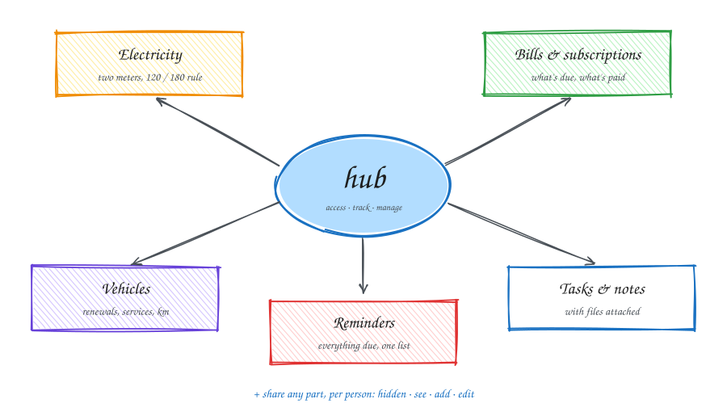
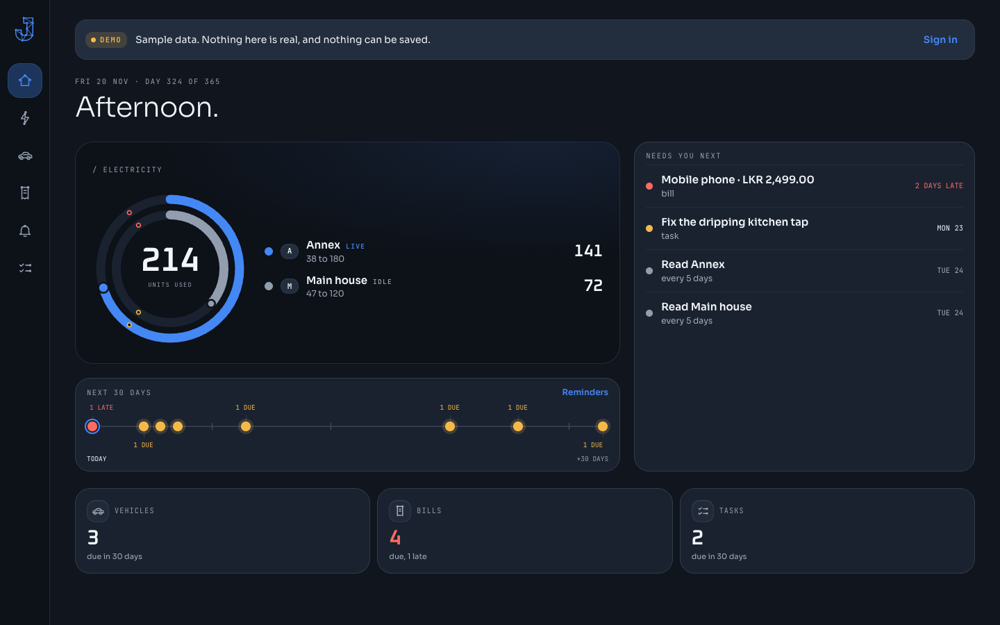
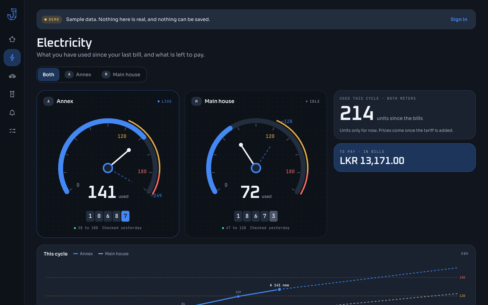
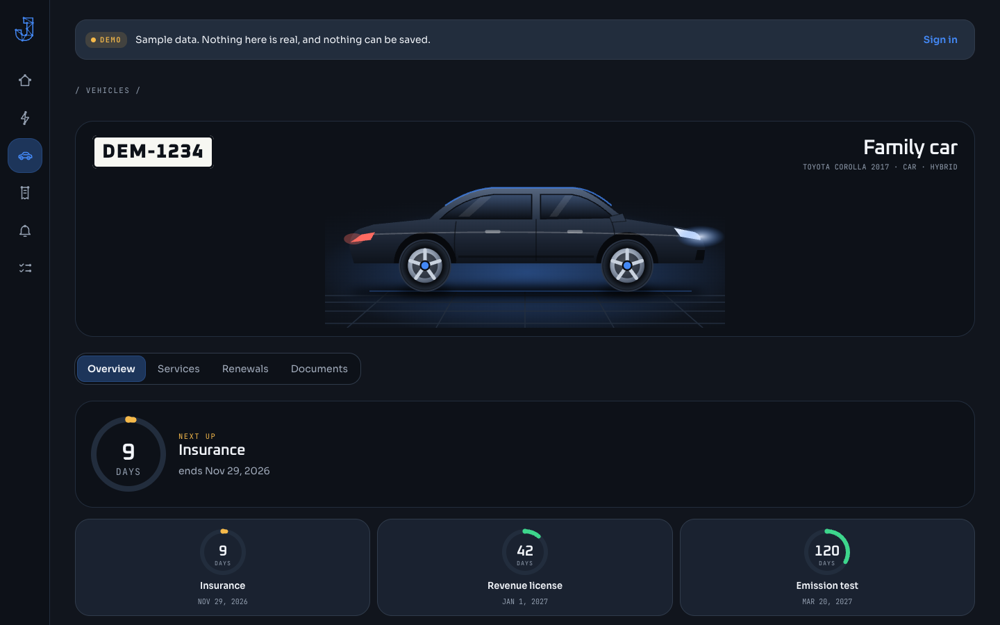
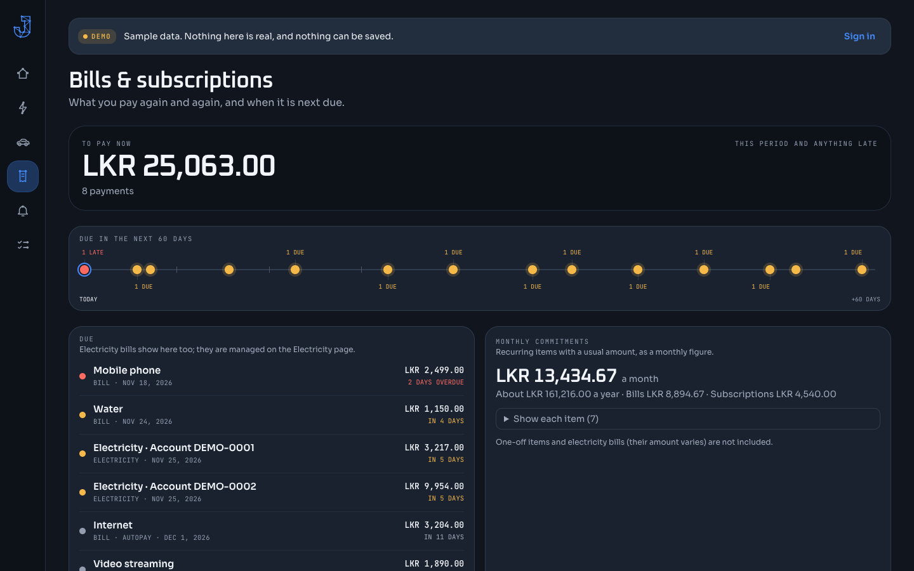
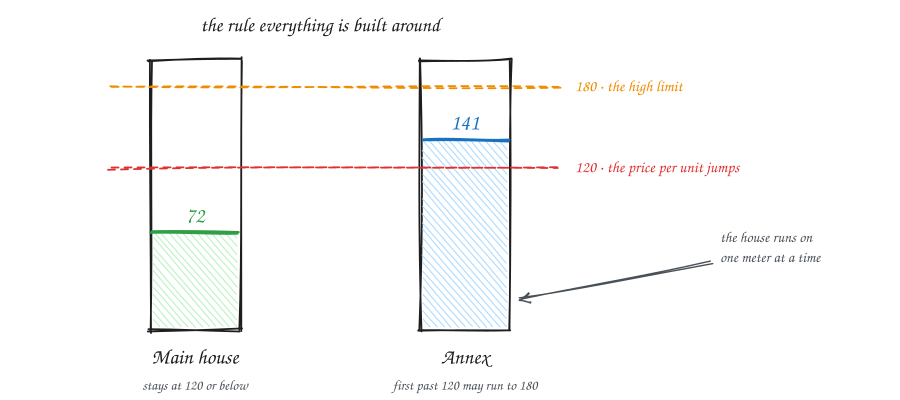
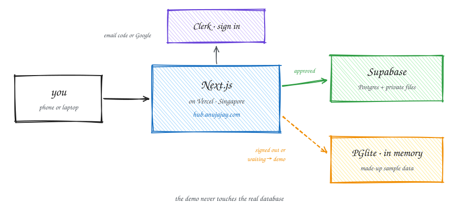
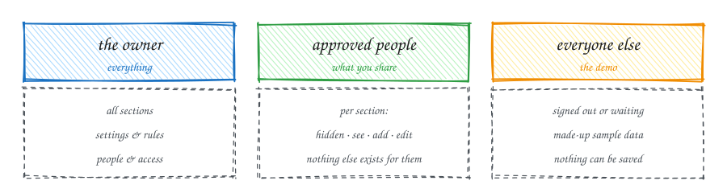
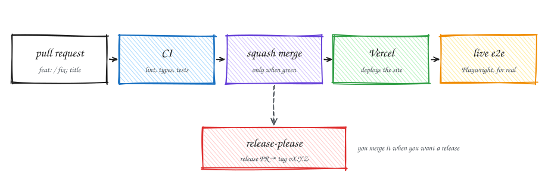

<picture>
  <source media="(prefers-color-scheme: dark)" srcset="design/brand/logo/png/lockup-horizontal-dark.png">
  
</picture>

**One private place to keep on top of the house.**

Two electricity meters on a slab tariff, the bills that come back every month, the vehicles and their
renewals, and one list of everything that is due. Built for one household in Sri Lanka, by one person.

[**Live demo**](https://hub.anujajay.com) · [**Changelog**](CHANGELOG.md) · [**Plan**](PLAN.md) · [**Decisions**](DECISIONS.md) · [**Design**](DESIGN.md) · [**Hosting**](HOSTING.md)

 

---

> [!NOTE]
> This is a personal app, not a product. There is nothing to install: the code is public so it can be read,
> and [the live site](https://hub.anujajay.com) opens a **demo with made-up data** for anyone who is not signed in.

<picture>
  <source media="(prefers-color-scheme: dark)" srcset="docs/readme/hub-map-dark.svg">
  
</picture>

## Why it exists

Running a house means keeping a lot of small things in your head: which meter the house is on this month,
when the water bill is due, whether the car's insurance runs out before the licence does. Each of them is
easy. Together they slip.

hub keeps them in one place, shows what needs you next, and shares the right parts with the people who help:
someone can add meter readings without ever seeing the bills.

## A look around

<table>
  <tr>
    <td width="50%"></td>
    <td width="50%"></td>
  </tr>
  <tr>
    <td align="center"><b>Home</b>: both meters, what needs you next, the next 30 days</td>
    <td align="center"><b>Electricity</b>: one instrument per meter, the slab limits on the dial</td>
  </tr>
  <tr>
    <td></td>
    <td></td>
  </tr>
  <tr>
    <td align="center"><b>A vehicle</b>: the plate in the address, renewals as countdowns</td>
    <td align="center"><b>Bills</b>: what to pay now, the next 60 days, the monthly total</td>
  </tr>
</table>

Screenshots from the live demo. Every name, plate, account and amount in them is made up.

## The rule everything is built around

The house has **two electricity meters**, and the price per unit jumps after **120 units** in a billing
cycle. So one meter should stay at 120 or below, while the other is allowed up to **180**. The first meter to
cross 120 becomes the one that may run high, and the house is switched to whichever meter is "live".

Every screen in the Electricity part answers one question: *which meter should the house be on right now,
and how much room is left?* The limits are editable in Settings, because tariffs change.

<picture>
  <source media="(prefers-color-scheme: dark)" srcset="docs/readme/slab-rule-dark.svg">
  
</picture>

## What it does

| Part | What you get |
| --- | --- |
| **Electricity** | Readings for both meters, the live meter, usage per cycle against the 120 / 180 limits, a projection to the end of the cycle, bills with due dates |
| **Bills & subscriptions** | Everything paid again and again: what is due, what is late, a calendar, and what it all costs per month |
| **Vehicles** | Each vehicle under its plate number, licence, insurance and emission test renewals, services, mileage and documents |
| **Reminders** | One list of everything due soon across every part, with lead times you choose |
| **Tasks & notes** | To-dos and notes, on their own or attached to a vehicle, a meter or a bill, with files |
| **Sharing** | People sign in by themselves and wait for approval; then each part is Hidden, See, Add or Edit for them |
| **Demo** | Anyone not approved sees the whole hub with sample data, so the app explains itself |

## How it works

<picture>
  <source media="(prefers-color-scheme: dark)" srcset="docs/readme/how-it-works-dark.svg">
  
</picture>

- **One Next.js app** (App Router, Server Components, Server Actions, cache components) on Vercel in Singapore,
  close to the database and to the people using it.
- **Every Server Action starts with an access check**, and a unit test fails if one does not. Pages hide
  what a person may not see; the server refuses what they may not do.
- **The demo cannot leak real data.** Signed-out visitors and people waiting for approval get an in-memory
  Postgres ([PGlite](https://pglite.dev)) built from the same migrations and filled with sample data. Pages
  read through one function that hands out the real database only to approved people, and a test fails if
  any other code reaches for it.
- **Files** go straight from the browser to a private storage bucket through one-time links, and open
  through short-lived signed links.

## Who sees what

<picture>
  <source media="(prefers-color-scheme: dark)" srcset="docs/readme/who-sees-what-dark.svg">
  
</picture>

## How it ships

<picture>
  <source media="(prefers-color-scheme: dark)" srcset="docs/readme/shipping-dark.svg">
  
</picture>

Every change is a GitHub issue and a pull request with a [Conventional Commits](https://www.conventionalcommits.org)
title. CI runs lint, types, unit tests and the production build; `main` only takes green, squash-merged pull
requests. Vercel deploys each merge, and then a **Playwright test runs against the live site**: it signs in a
TEST person, checks they see the demo while waiting, approves them for one section, checks they see only
that, uploads a file, and deletes everything it created. [release-please](https://github.com/googleapis/release-please)
turns the merged titles into the next version and its notes.

## Built with

| | |
| --- | --- |
| **App** | Next.js (App Router), React, TypeScript, Tailwind CSS, shadcn/ui on Base UI |
| **Data** | Supabase Postgres through Drizzle ORM, a private Supabase Storage bucket, PGlite for the demo |
| **Login** | Clerk (email code and Google), with the app's own approval and per-section access |
| **Hosting** | Vercel (Singapore), Cloudflare DNS |
| **Quality** | Vitest unit tests, Playwright end-to-end tests on the live site, GitHub Actions, release-please |
| **Design** | Its own brand: Oxanium, Sora and JetBrains Mono on dark charcoal with one blue ([DESIGN.md](DESIGN.md)) |

## How it was made

hub is built together with an AI coding agent, with the owner deciding every step. Nothing is merged, no
service is added and no data is touched without an explicit yes, and every answer is written down:

| Document | What is in it |
| --- | --- |
| [PLAN.md](PLAN.md) | The phases, from the foundation to hosting and CI/CD, and what is next |
| [DECISIONS.md](DECISIONS.md) | Every decision with its date and number (C = confirmed, P = pending, R = rejected) |
| [PRODUCT.md](PRODUCT.md) | Who it is for and what it is for |
| [DESIGN.md](DESIGN.md) | How it must look, down to the components |
| [HOSTING.md](HOSTING.md) | How the live site is set up |
| [CHANGELOG.md](CHANGELOG.md) | What each version changed |
| [CLAUDE.md](CLAUDE.md) | The working rules the agent follows |

## Status

The [latest release](https://github.com/Anuja-jayasinghe/personal-hub/releases) is what runs at [hub.anujajay.com](https://hub.anujajay.com):
every merge to `main` deploys, and the live test above runs right after. What each release changed is in the
[changelog](CHANGELOG.md); what comes next is in the [plan](PLAN.md).

## License

Released under the [MIT License](LICENSE). The hand-drawn font inside the diagrams is Excalidraw's Virgil, under the SIL Open Font License.

---

**Built by [Anuja Jayasinghe](https://anujajay.com)**

